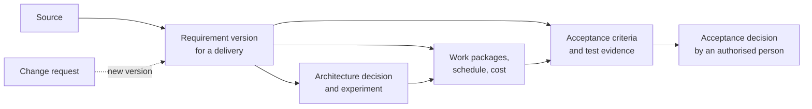

# From requirement to acceptance

**English** · [Русский](ru/README.md)

A customer ordered 10 pumps. The warehouse shipped 6, but the B2B portal still shows the order as “Open”. Sales ask for a “Partially shipped” status. Behind that request the project team sees two different outcomes. One customer only needs to know that the first truck has left. Another needs to see how many units are still to ship on every line. The second option needs warehouse data, a rule for repeated messages and new acceptance tests.

This is an open training case and a sample of Alexander Polomodov's consulting method. A fictional project is traced from the conversation with sales to the product owner's decision and the acceptance of a build. All events, observations and estimates were created for the example.

## The idea in one paragraph

Requirements, architecture, plans and acceptance usually live in different documents owned by different people, and they drift apart quietly. The method keeps them connected through one thing: **a requirement version tied to a specific delivery**. From that version you can find the source that justifies it, the architecture decision and the experiment behind it, the work packages and dates that depend on it, the test evidence for it, and the person with the authority to accept it. PMI practices supply the management side (scope, schedule, cost, who decides what). The Rational Unified Process supplies the engineering rhythm (test the riskiest assumption in an iteration before you commit). AI agents get the same chain as context through [OKF](https://github.com/open-knowledge-format/open-knowledge-format) cards, follow it through [skills](.agents/skills/), and are checked with [evals](evals/README.md) that catch the typical failure: a correct number presented as an approved commitment.



**Read the full method as a PDF (17 pages):** [English](methodology.pdf) · [Russian](ru/methodology.pdf). The case is on pages 7–9, skills and evals on pages 10–13, where to dig next on pages 16–17.

## Where to start

| If you want to | Open |
|---|---|
| Decide whether the method fits your team | [When to use the method](when-to-use.md). Symptoms, a quick self-check and the core of the approach. |
| Understand why a small change moved the acceptance date | [End-to-end walkthrough of partial shipments](example.md). It has the solution options, the work breakdown structure (WBS), the schedule before and after the change, the cost and four acceptance scenarios. |
| Work through a similar change in your own team | [The PMI and RUP method](method.md). Seven blocks connect the source of a requirement with the architecture decision, the work package, the test and the acceptor's authority. |
| Run a working session with an analyst, an architect and a project manager | [Consulting format](consulting-engagement.md). Diagnosis, pilot, and the point at which the team can run the next review on its own. |
| Delegate part of the work to an agent and check its output | [Team workshop](agent-practice.md). It comes with [OKF context cards](okf/index.md), [three skills](.agents/skills/) and [six eval tasks](evals/README.md). |
| Take the idea further | [Where to dig next](NEXT.md). Seven research and engineering directions, each with a first step, plus open questions. |

## How requirements, architecture and the plan connect

From the order-closed flag alone the portal cannot tell how many pumps have left. During the Rational Unified Process (RUP) elaboration phase the architect checks the warehouse data on a test bench. After the same 6-unit document is delivered twice, the portal must still show “shipped 6, remaining 4”. When a different document for 4 units arrives, the expected result becomes “shipped 10, remaining 0”. The order's accounting status may still be “Open” at that point. [Experiment log](okf/prototype.md)

When the product owner chooses the per-line remainder, the project manager uses PMI scope and schedule practices to recalculate the work. In the example this means **6 extra person-days and a 3-working-day shift in acceptance**. The reason for the difference is visible in the schedule: the screen and the warehouse integration are built in parallel. The decision record shows who chose the product behaviour and who accepted the changes to budget and date. [Delivery decision](okf/decision.md) · [Schedule and cost calculation](example.md)

## A first exercise with an agent

1. Give the agent the [analyst's notes as of the end of 6 October](okf/intake.md) and the [clarify-requirement skill](.agents/skills/clarify-requirement/SKILL.md). Ask what has already been promised to the customer, which options remain to choose from and who has the right to choose.
2. Compare the answer with the sources. If the agent already promises an exact remainder, ask it to point to the record in which the feature was approved and the field it took the quantity from. Then open the [experiment result](okf/prototype.md) and the [subsequent decision](okf/decision.md).
3. For an independent check, use six fresh situations. They vary the available data, the authority, the duration of parallel work and the completeness of the acceptance evidence. [Evals guide](evals/README.md)

To try the automated part without calling a model, grade the saved answers from the repository root. Python 3.7 or newer with the standard library is enough.

```sh
python3 evals/run.py --lang ru grade ru/evals/runs/2026-11-25-answers.json
```

The saved run is expected to score `6/6`. The script checks values and statuses. A reviewer reads the explanations separately against the rubric: an agent can calculate the remainder correctly and still wrongly claim that the customer has already seen it on the build under test.

## Languages

English is the primary language. The full Russian version, including the skills, OKF cards, eval tasks and PDF, is in [`ru/`](ru/README.md). The eval tasks have identical expected values in both languages, so `evals/run.py` grades English and Russian runs the same way (`--lang en` by default, `--lang ru` for the Russian set).

Both PDFs are generated from the markdown with `python3 tools/build_pdf.py` (needs `reportlab`). Edit the markdown, then rebuild; don't edit the PDF by hand. `python3 tools/check_repo.py` checks links and that the English and Russian eval sets match; CI runs it on every push.

## Work with me

This repository is also an example of the consulting I do with engineering and product teams: diagnosing one change, working through a requirement and architecture decision, and running a pilot that ends with the team doing the next review on its own. [What you can order and how it works](consulting-engagement.md) · [polomodov.tech](https://polomodov.tech) · [alex@polomodov.tech](mailto:alex@polomodov.tech)

## License

Texts, the PDF, OKF cards, skills and eval tasks are licensed under [CC BY 4.0](LICENSE). The code (`evals/run.py`, `tools/`) is licensed under [MIT](LICENSE-CODE). Please credit “Alexander Polomodov, From requirement to acceptance” with a link to this repository.
