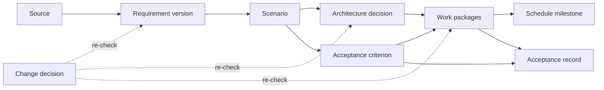

# How a team carries a decision through a project

Take one delivery and pick a result in it that a user can demonstrate or accept. Start with the nearest disputed decision. Ask the participants to show its basis, the version in force and the dependent work in the tools they already use. Build the chain for this result, then extend the rules that worked to the neighbouring ones.

## Seven blocks and the links between them

| Block | What the team decides | What the next participant receives |
|---|---|---|
| 1. Goal and boundaries | The product owner explains for whom the result will change and how to recognise the benefit. The project manager clarifies constraints, exclusions and the authority of the approvers. | The analyst receives the delivery boundary and the name of the person who will settle a dispute about its content. |
| 2. Evidence and requirements | The business analyst ties each statement to its source and identifies the user, conditions and exclusions. The product owner confirms the meaning. | The architect and the tester receive one version of the scenario with an observable result and a list of open questions. |
| 3. Architecture and risks | The architect compares options, isolates a testable assumption and runs an experiment. The decision record states the basis for the choice, the constraints and the trigger for revisiting it. | The team receives the solution boundary and the dependencies. The project manager sees which estimates can already be justified and where uncertainty remains. |
| 4. Work breakdown and plan | The project manager and the assignees break the scope down by deliverable, estimate the work, build the dependency network, and check resources and acceptance windows. | Package owners receive work boundaries and completion criteria. The approver sees the baseline, the forecast and the assumptions. |
| 5. Build and verification | The team builds a working slice. The tester compares behaviour with the criterion of the right version and records the build, the conditions and the result. | The acceptor receives reproducible evidence. A deviation goes back to the analyst or the assignee. |
| 6. Acceptance and outcome | The authorised acceptor records the outcome for the delivery. After use, the product owner checks whether the original goal was achieved. | The project manager closes accepted deliverables and plans the remainder. Operational data returns to block 1 as the basis for the next choice. |
| 7. Change control | At any step the analyst records the new position, the architect and the project manager assess the consequences, and the authorised participant chooses an option. | All affected owners receive one version of the decision with an effective date. They update requirements, tests and the baseline from it. |

**The working chain.** A source justifies a requirement. A scenario clarifies its meaning. An architecture decision implements the scenario; an acceptance criterion describes the observable result. One or more work packages deliver the implementation and the test. The activities of these packages are linked to schedule milestones. The acceptance record connects the version of the result, the criterion and the actual evidence. One architecture decision may serve several requirements, so a backward search is mandatory when a shared component changes.

## What to present at RUP phase boundaries

A phase contains one or more iterations. Requirements, design, implementation and testing can appear in any of them. A date in the plan marks a decision point. The basis for moving on is the result of the iteration. [Kroll and Kruchten, introduction to the Rational Unified Process](https://ptgmedia.pearsoncmg.com/images/0321166094/samplechapter/krollch01.pdf)

| Phase | Engineering evidence | Management decision |
|---|---|---|
| Inception | The goal, boundaries and key use cases are agreed. The main risks and their owners are named. | The sponsor decides whether to fund elaboration and which uncertainties to remove first. |
| Elaboration | A working prototype or an end-to-end slice confirms the essential properties of the architecture. The experiment's boundaries are recorded. | The architect and the project manager refine the scope and the forecast. The sponsor accepts the residual risk, asks for another experiment or changes the scope. |
| Construction | The team presents an integrated build and test results for the chosen delivery. | The project manager and the product owner decide readiness for hand-over, acceptable defects and remaining work. |
| Transition | The product has been tried in real use; feedback and the readiness of those who will support it are taken into account. | The acceptor records the result, the conditions of go-live and further commitments. The product owner schedules a check of the outcome. |

## How to link scope, effort and schedule

The work breakdown structure (WBS) describes the deliverables of the entire agreed scope. For the lowest level, write a short package description: what will be presented, which work is included, what is excluded, who is responsible and how it is accepted. Count shared integration and testing once. Check coverage in both directions: every accepted requirement must have work behind it, and every package must be grounded in the delivery scope or in project management tasks. [PMI, Practice Standard for Work Breakdown Structures](https://www.pmi.org/standards/work-breakdown-structures-third-edition)

For the schedule, turn packages into activities. Assignees estimate the effort and explain the basis for the estimate. The project manager calculates durations, taking into account people's availability, the sequence of activities, float and external windows. Keep the approved date, the current forecast and the “if we accept the change” date separately. Effort by role and the corresponding rates give the change in labour cost. For a full cost forecast, also include equipment, licences and other costs the decision affects. A new price or a binding date needs a decision by whoever has the authority to change them. [PMI, PMBOK Guide](https://www.pmi.org/standards/pmbok) · [GAO, Schedule Assessment Guide](https://www.gao.gov/products/gao-16-89g)

## How to resolve a conflict and issue a new version

1. **Establish what the dispute is about.** The analyst presents both statements, their sources and their scope. If the roles or conditions differ, the rules may coexist. If the conditions are the same, name the two incompatible outcomes. If the conditions are not specified enough, put the question to whoever knows them.
2. **Prepare the choice.** Keep the original version. For each option, show the change in behaviour, the architectural dependencies, the tests, the affected packages, and the date and cost forecast. Keeping the old rule, deferring, and swapping part of the scope are all valid options. For an unknown value, state the assumption and how to test it.
3. **Separate the authorities.** The product owner confirms the required behaviour. The architect confirms feasibility within the limits of the check that was run. The owner of the budget or contractual commitment accepts the financial and schedule consequences within their authority. One person may hold several roles if the mandate is defined in advance.
4. **Record the decision and feed it back into the plan.** Record the chosen option, the delivery, the version, the effective date and the basis. For a rejected option, keep the reason. After an accepted change, every owner of a material link checks it against the new version. Until that check is done, the dependent task stays open. Unrelated work can continue.

This is how a *semantic conflict* differs from a *link that needs re-checking*. The first is resolved by clarification or by choosing a rule. The second can arise after a change accepted unanimously. This way of maintaining links continues the practice of integrating Rational Rose with RequisitePro: a requirement is linked to a model element, and a change is a reason to review the dependent elements. [IBM, linking Rose models with RequisitePro](https://www.ibm.com/docs/en/rsas/7.5.0?topic=mrlm-importing-rose-models-that-are-linked-requisitepro-projects)

## The minimal record and the use of AI

For one material decision it is enough to record the ID, the delivery and version, the statement and its exclusions, the source with its exact location, the owner and status, and the links to the model, the test and the work package. After the decision, add the basis for the approval. For acceptance, state which build was tested, by whom and with what outcome. This information can live in an existing requirements register, issue tracker or linked documents.

If the project uses agents, separate knowledge about the product from instructions for doing the work. For example, an Open Knowledge Format (OKF) catalogue stores cards and the provenance of claims. A skill defines a procedure for extraction or comparison. An agent can find two versions of a rule and suggest the affected tests. A person with the corresponding authority confirms which version goes into the delivery. In a trial run, give the agent the old version and a newer comment that has not been approved. Check whether it kept both bases and addressed the question to the owner. Compare the analyst's effort with a manual review, including proofreading. [OKF specification](https://github.com/open-knowledge-format/open-knowledge-format/blob/main/SPEC.md) · [Agent Skills specification](https://agentskills.io/specification)

In the partial shipments example, the analyst receives the record with the original rule and the sales request, and the architect adds the results of the exchange on the test bench. Before the owner's choice, these materials justify the options. After the choice, the decision, the approved version and the test evidence join them. When reviewing an error in an agent's answer, you can establish exactly what was missing: a source, a pointer to authority, or a check of the calculation. [OKF cards](okf/index.md) · [Skills and evals workshop](agent-practice.md)
