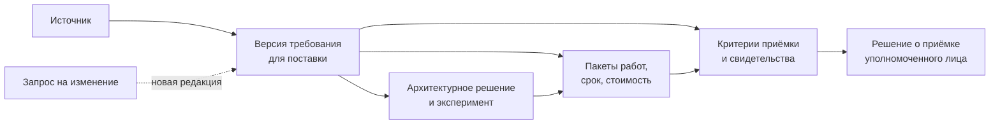

# От требования до приёмки

[English](../README.md) · **Русский**

Покупатель заказал 10 насосов. Склад отгрузил 6, а в B2B-портале заказ по-прежнему «Открыт». Отдел продаж просит добавить статус «Частично отгружен». Для проектной команды за этой просьбой стоят два разных результата. Одному покупателю достаточно знать, что первая машина выехала. Другому нужно видеть, сколько единиц осталось отгрузить по каждой позиции. Для второго варианта команде понадобятся данные склада, правило учёта повторных сообщений и новые проверки приёмки.

Это открытый учебный кейс и образец консультационной методики Александра Поломодова. Вымышленный проект разобран от разговора с продажами до решения владельца продукта и приёмки сборки. Все события, наблюдения и оценки созданы для примера.

## Идея в одном абзаце

Требования, архитектура, план и приёмка обычно живут в разных документах у разных людей и незаметно расходятся. Методика связывает их через одно звено: **версию требования, относящуюся к конкретной поставке**. От неё можно дойти до источника, который её обосновывает, до архитектурного решения и эксперимента за ним, до пакетов работ и дат, которые от неё зависят, до свидетельств проверки и до человека, у которого есть право принять результат. Практики PMI дают управленческую сторону: содержание, срок, стоимость и кто что решает. Rational Unified Process даёт инженерный ритм: проверить самое рискованное допущение в итерации до того, как брать обязательство. ИИ-агенты получают ту же цепочку как контекст через карточки [OKF](https://github.com/open-knowledge-format/open-knowledge-format), проходят её по [скиллам](.agents/skills/) и проверяются [эвалами](evals/README.md), которые ловят типичную ошибку: верное число, выданное за согласованное обязательство.



**Прочитать методику целиком (17 страниц)** — [PDF на русском](methodology.pdf) · [PDF на английском](../methodology.pdf). Кейс разобран на страницах 7–9, работа со скиллами и эвалами — на страницах 10–13, направления развития — на страницах 16–17.

## С чего начать

| Если вы хотите | Что открыть |
|---|---|
| Понять, подходит ли методика вашей команде | [Когда применять методику](when-to-use.md). Признаки проблемы, быстрая самопроверка и суть подхода. |
| Понять, почему небольшое изменение сдвинуло дату приёмки | [Сквозной разбор частичных отгрузок](example.md). В нём есть варианты решения, структура декомпозиции работ (WBS), календарь до и после изменения, стоимость и четыре сценария приёмки. |
| Разобрать похожее изменение в своей команде | [Методика PMI и RUP](method.md). Семь блоков связывают источник требования с решением об архитектуре, пакетом работ, проверкой и полномочиями принимающего. |
| Провести рабочую встречу с аналитиком, архитектором и руководителем проекта | [Формат консультации](consulting-engagement.md). Описаны диагностика, пилот и момент, когда команда может самостоятельно провести следующий разбор. |
| Поручить агенту часть работы и проверить его вывод | [Практикум для команды](agent-practice.md). К нему приложены [карточки контекста OKF](okf/index.md), [три скилла](.agents/skills/) и [шесть проверочных заданий](evals/README.md). |
| Развить идею дальше | [Куда копать дальше](NEXT.md). Семь исследовательских и инженерных направлений с первым шагом для каждого и открытые вопросы. |

## Как связаны требования, архитектура и план

По признаку закрытия заказа портал не может узнать, сколько насосов выехало. На этапе проработки Rational Unified Process (RUP) архитектор проверяет складские данные на стенде. После повторной доставки одного документа на 6 штук портал должен по-прежнему показать «отгружено 6, осталось 4». Когда приходит другой документ на 4 штуки, ожидаемый результат меняется на «отгружено 10, осталось 0». Учётный статус заказа при этом всё ещё может быть «Открыт». [Журнал эксперимента](okf/prototype.md)

Когда владелец продукта выбирает остаток по позициям, руководитель проекта использует практики управления содержанием и расписанием PMI для пересчёта работ. В примере это **6 дополнительных человеко-дней и сдвиг приёмки на 3 рабочих дня**. Причина разницы видна в календаре: экран и интеграцию со складом делают параллельно. В протоколе зафиксировано, кто выбрал поведение продукта и кто принял изменения бюджета и даты. [Решение по поставке](okf/decision.md) · [Расчёт календаря и затрат](example.md)

## Первое упражнение с агентом

1. Дайте агенту [записи аналитика на конец 6 октября](okf/intake.md) и [скилл уточнения требования](.agents/skills/clarify-requirement/SKILL.md). Спросите, что уже обещано покупателю, из каких вариантов предстоит выбрать и у кого есть право сделать выбор.
2. Сравните ответ с источниками. Если агент уже обещает точный остаток, попросите указать запись, в которой согласована функция, и поле, из которого он получил количество. Затем откройте [результат эксперимента](okf/prototype.md) и [последующее решение](okf/decision.md).
3. Для независимой проверки используйте шесть новых ситуаций. В них меняются доступные данные, полномочия, длительность параллельной работы и полнота свидетельств приёмки. [Инструкция к эвалам](evals/README.md)

Чтобы попробовать автоматическую часть без вызова модели, из корня репозитория проверьте сохранённые ответы. Достаточно Python 3.7 или новее и стандартной библиотеки.

```sh
python3 evals/run.py --lang ru grade ru/evals/runs/2026-11-25-answers.json
```

Для сохранённого прогона ожидается результат `6/6`. Скрипт сверяет значения и статусы. Проверяющий отдельно читает пояснения по рубрике: можно верно вычислить остаток и при этом ошибочно утверждать, что на проверяемой сборке его уже увидел покупатель.

## Языки

Основной язык репозитория — английский, он лежит в корне. Полная русская версия, включая скиллы, карточки OKF, задания эвалов и PDF, находится в этой папке `ru/`. Ожидаемые значения в заданиях совпадают в обоих языках, поэтому `evals/run.py` одинаково проверяет английские и русские прогоны (`--lang en` по умолчанию, `--lang ru` для русского набора).

Оба PDF собираются из markdown командой `python3 tools/build_pdf.py` (нужен `reportlab`). Правьте markdown и пересобирайте PDF, а не редактируйте его вручную. `python3 tools/check_repo.py` проверяет ссылки и совпадение английского и русского наборов эвалов; CI запускает её на каждый push.

## Работа со мной

Этот репозиторий — ещё и пример консалтинга, который я провожу для инженерных и продуктовых команд: диагностика одного изменения, проработка требования и архитектурного решения, пилот, после которого команда сама проводит следующий разбор. [Что можно заказать и как это устроено](consulting-engagement.md) · [polomodov.tech](https://polomodov.tech) · [alex@polomodov.tech](mailto:alex@polomodov.tech)

## Лицензия

Тексты, PDF, карточки OKF, скиллы и задания эвалов распространяются по лицензии [CC BY 4.0](../LICENSE). Код (`evals/run.py`, `tools/`) — по лицензии [MIT](../LICENSE-CODE). При использовании укажите «Александр Поломодов, От требования до приёмки» и ссылку на этот репозиторий.
